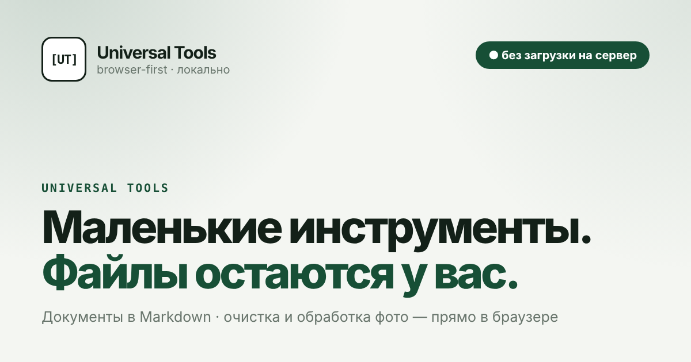
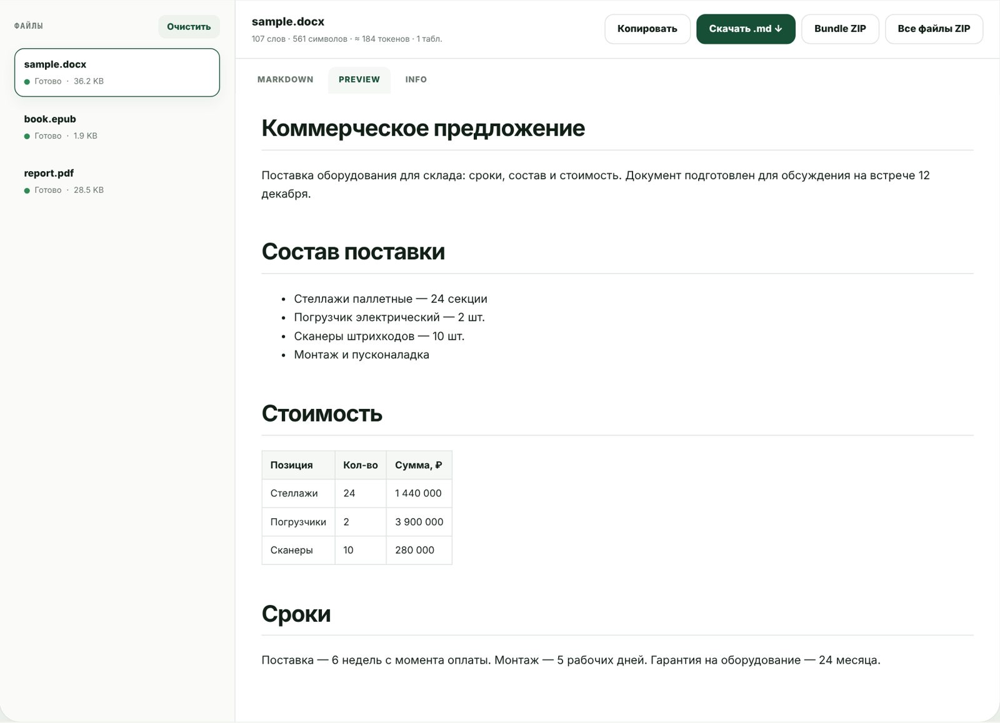
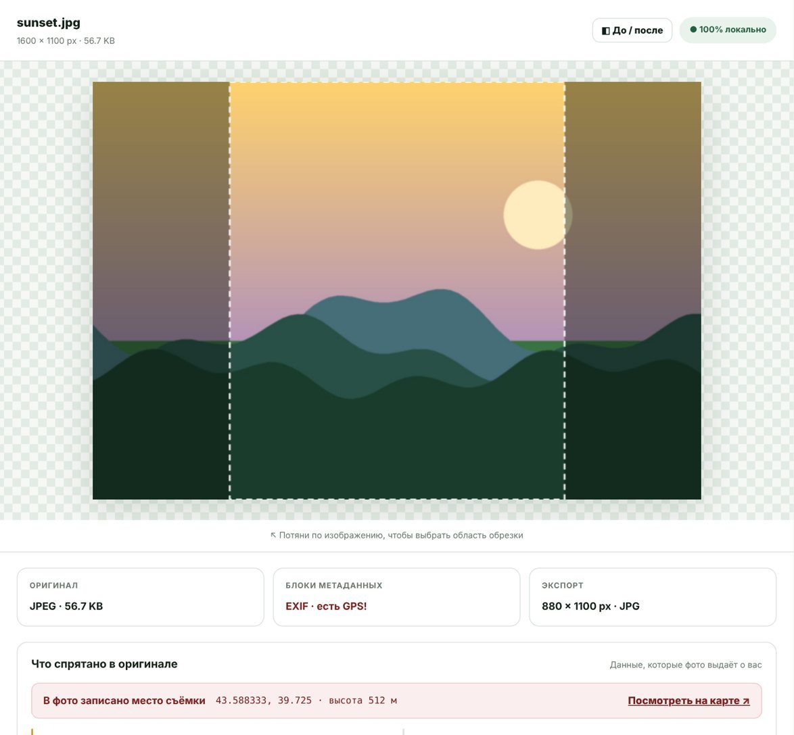
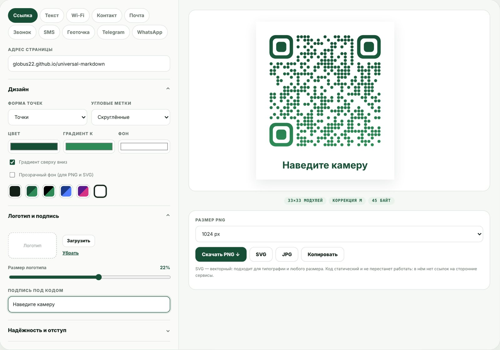
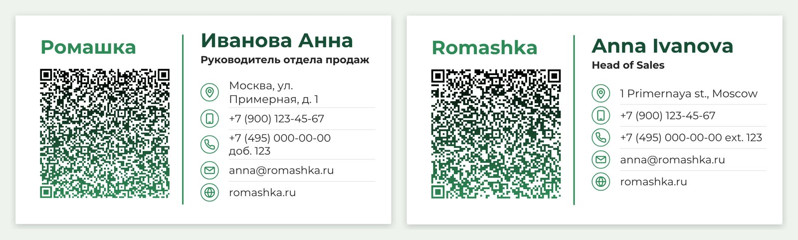
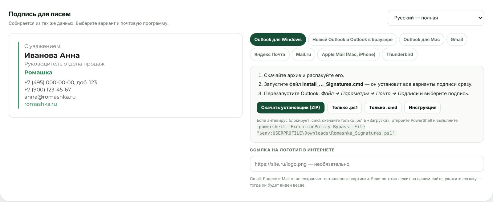
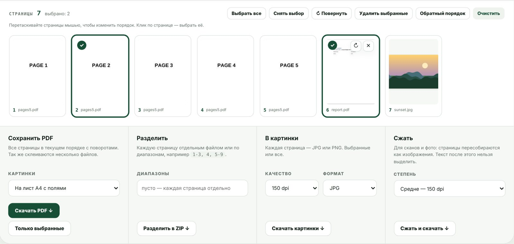
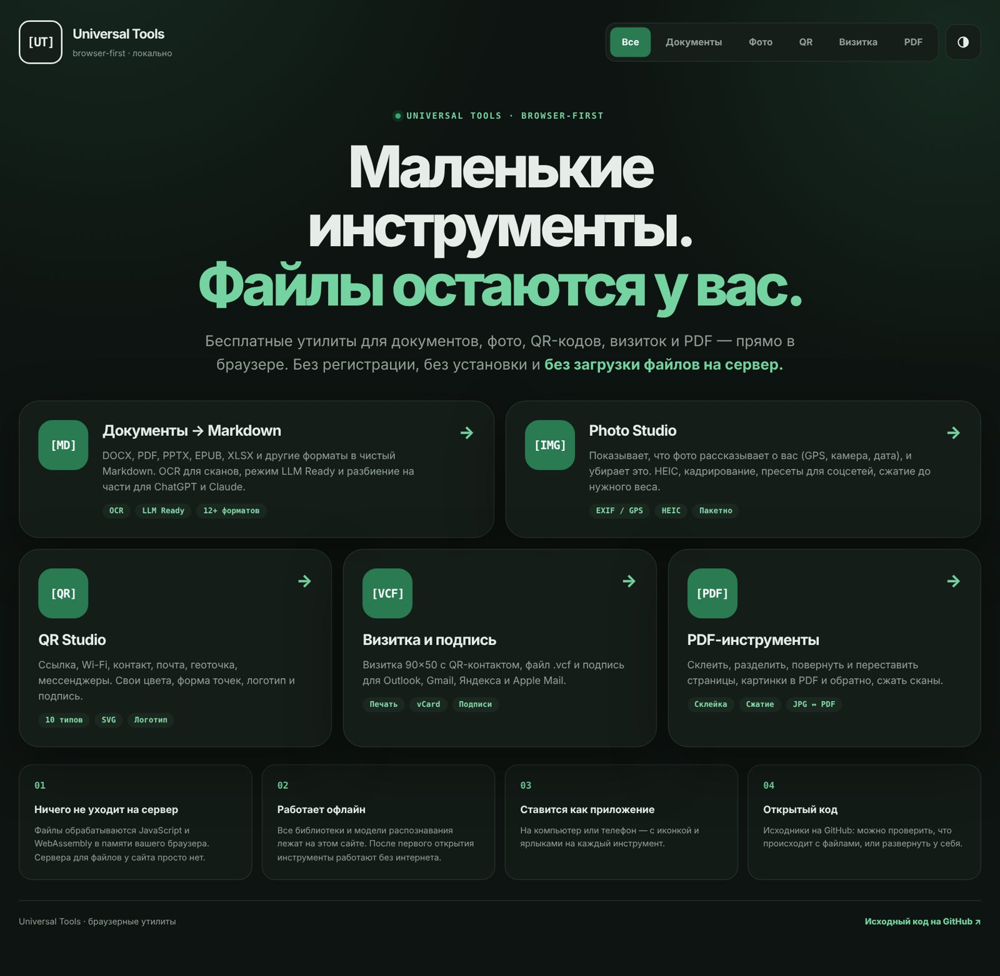

<div align="center">

<a href="https://globus22.github.io/universal-markdown/"></a>

**Бесплатные инструменты для документов, фото, QR-кодов, визиток и PDF — прямо в браузере.**<br>
Без регистрации, без установки и без загрузки файлов на сервер.

[**Открыть сайт →**](https://globus22.github.io/universal-markdown/)
&nbsp;·&nbsp; [Документы](https://globus22.github.io/universal-markdown/markdown.html)
&nbsp;·&nbsp; [Фото](https://globus22.github.io/universal-markdown/photo.html)
&nbsp;·&nbsp; [QR](https://globus22.github.io/universal-markdown/qr.html)
&nbsp;·&nbsp; [Визитка](https://globus22.github.io/universal-markdown/card.html)
&nbsp;·&nbsp; [PDF](https://globus22.github.io/universal-markdown/pdf.html)

`🔒 файлы не уходят на сервер` &nbsp; `📴 работает офлайн` &nbsp; `📱 ставится как приложение` &nbsp; `🌗 светлая и тёмная тема`

</div>

---

## Инструменты

<table>
<tr>
<td width="50%" valign="top">

### [MD] Документы → Markdown

DOCX, ODT, PDF, PPTX, EPUB, RTF, XLSX/XLS/ODS, CSV, HTML и картинки — в чистый Markdown.

- OCR для сканов и фото страниц (русский и английский)
- **LLM Ready**: убирает колонтитулы и повторы, режет на части по 10–50K токенов и копирует их по одной
- Таблицы, заголовки и картинки (Bundle ZIP с `assets/`)
- Вставка текста, HTML или скриншота через <kbd>Ctrl</kbd>+<kbd>V</kbd>

[Открыть →](https://globus22.github.io/universal-markdown/markdown.html)

</td>
<td width="50%"><a href="https://globus22.github.io/universal-markdown/markdown.html"></a></td>
</tr>
<tr>
<td width="50%"><a href="https://globus22.github.io/universal-markdown/photo.html"></a></td>
<td width="50%" valign="top">

### [IMG] Photo Studio

Показывает, что фото рассказывает о вас, и убирает это.

- **Что спрятано в оригинале**: место съёмки на карте, телефон, дата, автор, серийные номера
- Экспорт без EXIF, GPS и XMP — изображение кодируется заново
- HEIC с iPhone в любом браузере, JPG / PNG / WebP / AVIF
- Пресеты для соцсетей и форм, **лимит веса файла**, кадрирование, фильтры, «до / после»
- Пакетная обработка в ZIP

[Открыть →](https://globus22.github.io/universal-markdown/photo.html)

</td>
</tr>
<tr>
<td width="50%" valign="top">

### [QR] QR Studio

QR-код за минуту — красивый и рабочий.

- 10 типов: ссылка, текст, **Wi-Fi**, контакт, почта, звонок, SMS, геоточка, Telegram, WhatsApp
- Форма точек и угловых меток, цвет и градиент, прозрачный фон
- Логотип в центре и подпись под кодом
- Предупреждает, если код может плохо читаться
- PNG до 4096 px, **SVG** для печати, JPG. Без сервисов-посредников — код работает всегда

[Открыть →](https://globus22.github.io/universal-markdown/qr.html)

</td>
<td width="50%"><a href="https://globus22.github.io/universal-markdown/qr.html"></a></td>
</tr>
<tr>
<td colspan="2"><a href="https://globus22.github.io/universal-markdown/card.html"></a></td>
</tr>
<tr>
<td width="50%" valign="top">

### [VCF] Визитка и подпись

Печатная визитка, цифровой контакт и подпись для писем — из одних данных.

- Визитка 90×50 мм, одна или две стороны, свой логотип, цвета и шрифт
- Текст подгоняется сам: длинная должность или адрес аккуратно уменьшаются
- QR, который сохраняет контакт в телефон, и файл `.vcf`
- Печать в PDF, лист A4 с метками реза, вылеты 3 мм, PNG 1200 dpi, SVG
- **Подпись для любой почты**: установщик для Outlook на Windows и инструкции для нового Outlook, Outlook для Mac, Gmail, Яндекса, Mail.ru, Apple Mail и Thunderbird

[Открыть →](https://globus22.github.io/universal-markdown/card.html)

</td>
<td width="50%"><a href="https://globus22.github.io/universal-markdown/card.html"></a></td>
</tr>
<tr>
<td width="50%" valign="top">

### [PDF] PDF-инструменты

Собрать, разделить, сжать — без загрузки.

- Несколько PDF и картинок в одной сетке страниц
- Перетаскивание, поворот, удаление и выбор страниц
- Склейка и извлечение **без перекодирования** — текст и качество сохраняются
- Разделение по диапазонам `1-3, 4, 5-end`
- PDF → JPG/PNG, картинки → PDF на листах A4
- Сжатие сканов (например, 15,8 МБ → 0,6 МБ)

[Открыть →](https://globus22.github.io/universal-markdown/pdf.html)

</td>
<td width="50%"><a href="https://globus22.github.io/universal-markdown/pdf.html"></a></td>
</tr>
</table>

## Почему так

- 🔒 **Приватно.** Файлы обрабатываются JavaScript и WebAssembly в памяти браузера. Сервера для них у сайта просто нет — это можно проверить во вкладке «Сеть» в инструментах разработчика.
- 📴 **Офлайн.** Все библиотеки, шрифты и модели распознавания лежат в репозитории, сторонние CDN не используются. После первого открытия инструменты работают без интернета.
- 📱 **Как приложение.** Сайт устанавливается на компьютер или телефон (PWA) с ярлыками на каждый инструмент.
- 🎁 **Бесплатно.** Без регистрации, подписок, водяных знаков и лимитов.

<div align="center">

<br><sub>Тёмная тема включается автоматически по настройкам системы или кнопкой в шапке</sub>
</div>

## Запуск у себя

```bash
git clone https://github.com/globus22/universal-markdown.git
cd universal-markdown
python3 -m http.server 8080
```

Откройте <http://localhost:8080>. Сборка не нужна: это обычные HTML, CSS и JavaScript.

Публикация на GitHub Pages: **Settings → Pages → Deploy from a branch → `main` / root**.

> [!TIP]
> После изменения файлов увеличьте версию `CACHE` в `sw.js`, чтобы установленные копии сайта получили обновление.

<details>
<summary><b>Структура проекта</b></summary>

```
├── index.html            главная — каталог инструментов
├── markdown.html         [MD] Документы → Markdown
├── photo.html            [IMG] Photo Studio
├── qr.html               [QR] QR Studio
├── card.html             [VCF] Визитка и подпись
├── pdf.html              [PDF] PDF-инструменты
├── css/
│   ├── common.css        общий дизайн: цвета, темы, шапка, кнопки, поля, футер
│   ├── fonts.css         шрифты для макетов визиток
│   └── hub · markdown · photo · qr · card · pdf .css
├── js/
│   ├── common.js         тема, установка приложения, офлайн-кэш
│   ├── shared/qr.js      QR: матрица, стили, vCard, Wi-Fi и другие форматы
│   ├── markdown/         конвертер: утилиты и реестр форматов, OCR, обработка текста, форматы, интерфейс
│   ├── photo/            метаданные и интерфейс фоторедактора
│   ├── qr/               интерфейс QR Studio
│   ├── card/             вёрстка визитки, подписи и установщик, интерфейс
│   └── pdf/              PDF-инструменты
├── vendor/               сторонние библиотеки, шрифты и OCR-модели (см. vendor/README.md)
├── icons/  og/           иконки приложения и картинки для превью ссылок
├── docs/screenshots/     скриншоты для этого README
├── sw.js                 service worker: офлайн-кэш
└── manifest.webmanifest  PWA-манифест
```

Скрипты подключаются обычными `<script>` без сборщика, поэтому сайт работает и с GitHub Pages, и с любого статического хостинга.

</details>

<details>
<summary><b>Для разработчиков: новый формат и новая страница</b></summary>

**Новый формат в конвертере.** Напишите функцию `extract(file, ctx)`, которая возвращает `{ markdown, assets, meta }`, и зарегистрируйте её — список форматов в интерфейсе обновится сам:

```js
UMD.formats.register({ exts: ['abc'], label: 'ABC', extract: extractAbc });
```

**Новая страница-инструмент.** Соберите её из общих блоков `common.css`: `.topbar` + `.nav`, `.hero`, `.card`, `.drop-zone`, `.btn` (`solid` / `dark` / `line` / `subtle` / `pill`), `.field`, `.notice`, `.promo`, `.features`, `.footnote`, `footer`. Цвета — только через CSS-переменные из `:root`, иначе сломается тёмная тема. Добавьте страницу в меню всех страниц, в `sw.js` и в `manifest.webmanifest`.

</details>

<details>
<summary><b>Ограничения</b></summary>

- **Документы:** OCR больших PDF ресурсоёмок; PDF.js не восстанавливает сложные таблицы и многоколоночную вёрстку; EPUB с DRM и старые `.doc` / `.ppt` не поддерживаются.
- **Фото:** Canvas не гарантирует точного сохранения цветовых профилей; информация, нанесённая прямо на изображение, не удаляется; GIF сохраняется первым кадром.
- **Визитка:** Gmail, Яндекс и Mail.ru не сохраняют вставленные картинки — для логотипа в подписи укажите ссылку на него в интернете.
- **PDF:** сжатие превращает страницы в изображения — текст после него нельзя выделить; защищённые паролем файлы не открываются.

</details>

## Библиотеки

[Mammoth](https://github.com/mwilliamson/mammoth.js) · [Turndown](https://github.com/mixmark-io/turndown) · [SheetJS](https://sheetjs.com) · [PDF.js](https://mozilla.github.io/pdf.js/) · [pdf-lib](https://pdf-lib.js.org) · [Tesseract.js](https://tesseract.projectnaptha.com) · [JSZip](https://stuk.github.io/jszip/) · [marked](https://marked.js.org) · [DOMPurify](https://github.com/cure53/DOMPurify) · [exifr](https://github.com/MikeKovarik/exifr) · [heic2any](https://github.com/alexcorvi/heic2any) · [qrcode-generator](https://github.com/kazuhikoarase/qrcode-generator) · шрифты Montserrat, Inter и PT Serif ([Fontsource](https://fontsource.org)).
Версии и лицензии — в [`vendor/README.md`](vendor/README.md).
